# AstroPaper 📄


[](https://www.figma.com/community/file/1356898632249991861)


[](https://conventionalcommits.org)
[](http://commitizen.github.io/cz-cli/)

AstroPaper is a minimal, responsive, accessible and SEO-friendly Astro blog theme. This theme is designed and crafted based on [my personal blog](https://satnaing.dev/blog).

Read [the blog posts](https://astro-paper.pages.dev/posts/) or check [the README Documentation Section](#-documentation) for more info.

## 🔥 Features

- [x] type-safe markdown
- [x] super fast performance
- [x] accessible (Keyboard/VoiceOver)
- [x] responsive (mobile ~ desktops)
- [x] SEO-friendly
- [x] light & dark mode
- [x] static search ([Pagefind](https://pagefind.app/))
- [x] draft posts & pagination
- [x] sitemap & rss feed
- [x] MDX support
- [x] collapsible table of contents
- [x] followed best practices
- [x] highly customizable
- [x] dynamic OG image generation for blog posts ([Blog Post](https://astro-paper.pages.dev/posts/dynamic-og-image-generation-in-astropaper-blog-posts/))
- [x] i18n ready

_Note: I've tested screen-reader accessibility of AstroPaper using **VoiceOver** on Mac and **TalkBack** on Android. I couldn't test all other screen-readers out there. However, accessibility enhancements in AstroPaper should be working fine on others as well._

## ✅ Lighthouse Score

<p align="center">
  <a href="https://pagespeed.web.dev/report?url=https%3A%2F%2Fastro-paper.pages.dev%2F&form_factor=desktop">
    
  </a>
</p>

## 🚀 Project Structure

Inside of AstroPaper, you'll see the following folders and files:

```bash
/
├── public/
│   ├── pagefind/          # auto-generated on build
│   ├── favicon.svg
│   └── default-og.jpg
├── src/
│   ├── assets/
│   │   ├── icons/
│   │   └── images/
│   ├── components/
│   ├── content/
│   │   ├── pages/
│   │   │   └── about.md
│   │   └── posts/
│   │       └── some-blog-posts.md
│   ├── i18n/
│   ├── layouts/
│   ├── pages/
│   ├── scripts/
│   ├── styles/
│   ├── types/
│   ├── utils/
│   ├── config.ts
│   └── content.config.ts
├── astro-paper.config.ts  # user-defined configurations
└── astro.config.ts
```

All blog posts are stored in the `src/content/posts/` directory. You can organise posts into subdirectories — the subdirectory name becomes part of the post URL.

## 📖 Documentation

Documentation can be read in two formats\_ _markdown_ & _blog post_.

- Configuration - [markdown](src/content/posts/how-to-configure-astropaper-theme.md) | [blog post](https://astro-paper.pages.dev/posts/how-to-configure-astropaper-theme/)
- Add Posts - [markdown](src/content/posts/adding-new-post.md) | [blog post](https://astro-paper.pages.dev/posts/adding-new-posts-in-astropaper-theme/)
- Customize Color Schemes - [markdown](src/content/posts/customizing-astropaper-theme-color-schemes.md) | [blog post](https://astro-paper.pages.dev/posts/customizing-astropaper-theme-color-schemes/)
- Predefined Color Schemes - [markdown](src/content/posts/predefined-color-schemes.md) | [blog post](https://astro-paper.pages.dev/posts/predefined-color-schemes/)

## 💻 Tech Stack

**Main Framework** - [Astro](https://astro.build/)  
**Type Checking** - [TypeScript](https://www.typescriptlang.org/)  
**Styling** - [TailwindCSS](https://tailwindcss.com/)  
**UI/UX** - [Figma Design File](https://www.figma.com/community/file/1356898632249991861)  
**Static Search** - [Pagefind](https://pagefind.app/)  
**Icons** - [Tablers](https://tabler-icons.io/)  
**Code Formatting** - [Prettier](https://prettier.io/)  
**Deployment** - [Cloudflare Pages](https://pages.cloudflare.com/)  
**Linting** - [ESLint](https://eslint.org)  
**Dynamic OG images** - [Satori](https://github.com/vercel/satori) + [Sharp](https://sharp.pixelplumbing.com/) + [Astro Fonts](https://docs.astro.build/en/guides/fonts/)

## 👨🏻‍💻 Running Locally

You can start using this project locally by running the following command in your desired directory:

```bash
# pnpm
pnpm create astro@latest --template satnaing/astro-paper

# pnpm
pnpm create astro@latest -- --template satnaing/astro-paper

# yarn
yarn create astro --template satnaing/astro-paper

# bun
bun create astro@latest -- --template satnaing/astro-paper
```

Then start the project by running the following commands:

```bash
# install dependencies if you haven't done so in the previous step.
pnpm install

# start running the project
pnpm dev
```

## Raven 背景

`public/raven-castle-marked.png` 复用自 `raven-site/public/`。全站共享该背景，沿用官网的明暗主题滤镜与中央渐变；图片随页面向下淡出，避免干扰长文阅读。主题底色与官网一致，背景通过现有主题按钮切换。

## 中文界面

英文入口为 `/`，简体中文入口为 `/zh/`，导航中的“中文 / English”可以在对应页面之间切换。

中文路由复用现有页面入口和文章集合，覆盖导航、日期、搜索、文章操作、关于页与 RSS。迁移的 8 篇文章提供独立的中英文标题、摘要与完整正文；模板示例文章仍保留原文。

界面文案位于 `src/i18n/lang/zh.ts`，中文关于页位于 `src/content/pages/about-zh.md`。切换语言会完整加载页面，以重置 Pagefind 缓存的搜索语言；修改文章后运行 `pnpm build` 更新两种语言的搜索索引。

构建完成后运行 `pnpm test:i18n`，检查本地化链接、分页、日期、RSS 和搜索索引。

## Obsidian 文章

2026-10-10 将选定的 8 个选题整理到 `src/content/posts/obsidian/`，保留 Obsidian 原笔记。迁移稿合并相关笔记、清理内部地址与凭证，并用通用示例描述工作案例；未迁移整个笔记库或无关附件。

| 文章                                            | 中文版                                                                | 英文版                                                                       |
| ----------------------------------------------- | --------------------------------------------------------------------- | ---------------------------------------------------------------------------- |
| 用一个 C 小程序，看懂补码、字节序和浮点数       | [中文](src/content/posts/obsidian/bitview-memory-representation.md)   | [English](src/content/posts/obsidian/_en/bitview-memory-representation.md)   |
| OAuth 回调遇到 hash 路由：参数为什么读不到？    | [中文](src/content/posts/obsidian/oauth-callback-hash-routing.md)     | [English](src/content/posts/obsidian/_en/oauth-callback-hash-routing.md)     |
| 隐藏页面还不够：交付配置与账号权限如何共同生效  | [中文](src/content/posts/obsidian/delivery-config-and-permissions.md) | [English](src/content/posts/obsidian/_en/delivery-config-and-permissions.md) |
| 任务系统里的时间：绝对时刻、当地时间与“全天”    | [中文](src/content/posts/obsidian/task-time-model.md)                 | [English](src/content/posts/obsidian/_en/task-time-model.md)                 |
| 让 AI 写代码前，先完成研究与计划                | [中文](src/content/posts/obsidian/ai-coding-research-and-plan.md)     | [English](src/content/posts/obsidian/_en/ai-coding-research-and-plan.md)     |
| 连续调用三次 setState，为什么只加了一次？       | [中文](src/content/posts/obsidian/react-state-snapshot.md)            | [English](src/content/posts/obsidian/_en/react-state-snapshot.md)            |
| Go 并发结果为什么每次不同：从共享计数到竞态检测 | [中文](src/content/posts/obsidian/go-concurrency-race.md)             | [English](src/content/posts/obsidian/_en/go-concurrency-race.md)             |
| PostgreSQL 导入数据后，自增主键为什么冲突？     | [中文](src/content/posts/obsidian/postgres-sequence-after-import.md)  | [English](src/content/posts/obsidian/_en/postgres-sequence-after-import.md)  |

这 8 篇的两个版本均为 `draft: false`。中文版标记 `lang: zh`，英文版位于 `_en/` 并标记 `lang: en`；列表、标签、归档、RSS 和搜索分别使用当前语言。未设置 `lang` 的模板文章继续在两种界面中共享。

`_en` 沿用现有路径规则，不进入公开 URL，因此两种版本保留同一文章路径：英文为 `/posts/obsidian/<文件名>/`，中文为 `/zh/posts/obsidian/<文件名>/`，导航语言按钮可切换到对应正文。新增翻译时应使用相同文件名、日期和标签。首页“最近文章”显示最新 4 篇，其余可在文章列表翻页查看。

搜索使用构建生成的 Pagefind 索引，修改文章后运行 `pnpm build` 更新索引，重启开发服务不会自动更新搜索索引。文首注释保留仍需核验的来源归属、示例运行或业务公开范围。将两个版本都设为 `draft: true` 可恢复整篇隐藏状态。

## Google Site Verification (optional)

You can add your [Google Site Verification HTML tag](https://support.google.com/webmasters/answer/9008080#meta_tag_verification&zippy=%2Chtml-tag) by setting `site.googleVerification` in `astro-paper.config.ts`:

```ts file="astro-paper.config.ts"
export default defineAstroPaperConfig({
  site: {
    // ...
    googleVerification: "your-google-site-verification-value",
  },
  // ...
});
```

> See [this discussion](https://github.com/satnaing/astro-paper/discussions/334#discussioncomment-10139247) for adding AstroPaper to the Google Search Console.

## 🧞 Commands

All commands are run from the root of the project, from a terminal:

| Command          | Action                                                                                                                           |
| :--------------- | :------------------------------------------------------------------------------------------------------------------------------- |
| `pnpm install`   | Installs dependencies                                                                                                            |
| `pnpm dev`       | Starts local dev server at `localhost:4321`                                                                                      |
| `pnpm build`     | Type-checks, builds the site, runs Pagefind indexing, and copies the index to `public/pagefind/`                                 |
| `pnpm preview`   | Preview your build locally, before deploying                                                                                     |
| `pnpm sync`      | Generates TypeScript types for all Astro modules. [Learn more](https://docs.astro.build/en/reference/cli-reference/#astro-sync). |
| `pnpm astro ...` | Run CLI commands like `astro add`, `astro check`                                                                                 |

## ✨ Feedback & Suggestions

If you have any suggestions/feedback, you can contact me via [my email](mailto:satnaingdev+astropaper@gmail.com). Alternatively, feel free to open an issue if you find bugs or want to request new features.

## 📜 License

Licensed under the MIT License, Copyright © 2026

---

Made with 🤍 by [Sat Naing](https://satnaing.dev) 👨🏻‍💻 and [contributors](https://github.com/satnaing/astro-paper/graphs/contributors).
